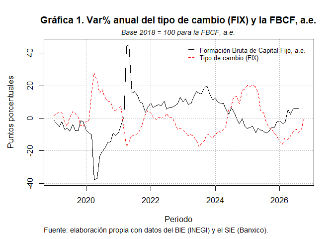
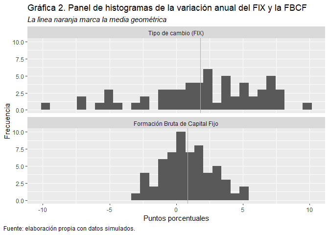

# seriesMX

Consulta, procesamiento y visualización de series macroeconómicas de
México mediante las API del Banco de Información Económica (BIE) de
INEGI y del Sistema de Información Económica (SIE) de Banco de México.

## Introducción

Las API’s web institucionales son el medio por el cual se presentan
diversos indicadores de la economía mexicana al público general para que
investigadores y desarrolladores consulten los datos de una manera
eficiente y segura.

seriesMX es un paquete de R que automatiza la descarga, procesamiento,
visualización y actualización de diversos indicadores de la economía
mexicana a través del uso de las API web del Sistema de Información
Económica (SIE) de Banco de México (Banxico), y del Banco de Información
Económica (BIE) del Instituto Nacional de Estadística y Geografía
(INEGI).

¿Por qué se clasifican como API’s Web?

Una API web (Application Programming Interface o Interfaz de
Programación de Aplicaciones) es un conjunto de reglas y protocolos que
permite que diferentes aplicaciones o sistemas se comuniquen e
intercambien datos a través de internet, utilizando principalmente el
protocolo HTTP/HTTPS.

Para más información consultar: <https://www.ibm.com/think/topics/api>

En ese sentido, para acceder a los datos a través de las API’s web no es
necesario instalar algún software. En su lugar, se realiza una petición
web (una solicitud HTTP) por medio de una dirección URL específica
provista por los sistemas informáticos de INEGI y Banxico. Al momento de
llevar a cabo la consulta, los servidores procesan la petición y
devuelven la información en formatos estructurados estándar de
intercambio de datos web, principalmente JSON o JSON-Stat.

Sin embargo, es importante señalar que ambos sistemas requieren que se
lleve a cabo un registro en sus “portales de desarrolladores” para
obtener un `token` de autenticación, el cual viaja junto con la petición
web para registar y validar el acceso del usuario.

# Portal de desarrolladores de Banxico e INEGI

A través de estos portales, los desarrolladores o analistas que
requieren automatizar el proceso de extracción de información económica
publicada por INEGI y Banxico, pueden acceder a los datos
correspondientes.

- INEGI (BIE/BISE):

<https://www.inegi.org.mx/servicios/api_indicadores.html>

<https://www.inegi.org.mx/servicios/api-indicadores/>

- Banxico (SIE):

<https://www.banxico.org.mx/SieAPIRest/service/v1/>

Para consultar la dirección URL de la información asociada a los
indicadores, los usuarios deben seleccionar el “Constructor de
Consultas” en el caso del API de INEGI o el “Catálogo de series” en el
caso de Banxico.

Cualquier lenguaje de programación que tenga la capacidad de conectarse
a internet (como Python, R o incluso macros avanzadas de Excel) puede
consumir estas herramientas enviando peticiones HTTPS de forma remota.

# Acceso al token de autenticación para realizar las peticiones de información a las API del BIE o SIE

Antes de consultar las API del BIE y el SIE, es indispensable consultar
los siguientes enlaces para generar los token de autenticación
correspondientes:

- INEGI (BIE/BISE):

<https://www.inegi.org.mx/app/desarrolladores/generatoken/Usuarios/token_Verify>

- Banco de México (SIE):

<https://www.banxico.org.mx/SieAPIRest/service/v1/token>

Nota: en la práctica es posible generar más de un token de
autenticación, su propósito sólo es controlar el flujo de acceso a las
API de INEGI y Banxico.

## Instalación del paquete seriesMX

``` r
# install.packages("pak")
pak::pak("carrascofernando032/seriesMX")
library(seriesMX)
```

## 1. Consultar el catálogo de los indicadores del BIE (INEGI) y del SIE (Banxico) por medio del paquete seriesMX

Los catálogos denominados `catalogo_maestro_banxico` y
`catalogo_maestro_inegi` se incluyen como data frames en la base del
paquete seriesMX. No es necesario descargar ni cargar algún archivo
externo.

Es posible inspeccionarlos como data frames, filtrarlos y obtener sus
claves o URL antes de solicitar los datos. Para consultar las tablas
incluidas no es necesario registrar los token de autenticación; para
descargar los datos sí es necesario.

Estos catálogos están compuestos por: 221,047 indicadores con claves
únicas del BIE (INEGI) y del SIE(Banxico).

La contribución de INEGI representa el 40.51% de las claves; la de
Banxico, el 59.49%. Esta composición combina indicadores del sector real
con información monetaria y financiera.

No implica que ambas fuentes tengan coberturas mutuamente excluyentes:
pueden medir fenómenos relacionados o difundir series derivadas.

| Objeto                     |   Filas | Claves únicas | Columnas |
|----------------------------|--------:|--------------:|---------:|
| `catalogo_maestro_inegi`   |  89,782 |        89,535 |       20 |
| `catalogo_maestro_banxico` | 140,527 |       131,512 |       14 |

Las filas conservan las rutas temáticas de cada indicador. Una clave
repetida no representa necesariamente otra serie: en estos catálogos,
cada clave tiene una sola URL distinta.

## Catálogo de indicadores del BIE (INEGI)

En el portal de desarrolladores de INEGI los indicadores están
clasificados en una o más rutas temáticas denominadas segmento:

| Segmento | Indicadores |
|----|---:|
| `Manufacturas` | 37,204 |
| `Cuentas nacionales` | 27,331 |
| `Sector externo` | 9,970 |
| `Indicadores economicos de coyuntura` | 5,874 |
| `Indicadores de productividad. Base 2018` | 4,730 |
| `Encuesta mensual de servicios (EMS). Base 2018` | 1,800 |
| `Ocupación, empleo y remuneraciones` | 1,063 |
| `Encuesta mensual sobre empresas comerciales (EMEC). Base 2018` | 551 |
| `Encuesta Nacional de Empresas Constructoras (ENEC). Serie 2018` | 373 |
| `Comunicaciones y transportes` | 304 |
| `Encuesta Anual de Empresas Constructoras (EAEC). Serie 2018` | 219 |
| `Proyectos especiales` | 210 |
| `Minería` | 106 |
| `Finanzas públicas` | 47 |

Fuente: cálculo directo sobre data/catalogo_maestro_inegi.rda del commit
revisado. Una clave BIE y una clave SIE pertenecen a sistemas distintos.

## Catálogo de indicadores del SIE (Banxico)

Los indicadores del SIE (Banxico) están clasificados en una o más rutas
temáticas denominadas sector:

| Sector | Indicadores |
|----|---:|
| `Financiamiento e información financiera de intermediarios financieros` | 10,9247 |
| `Balanza de pagos` | 14,596 |
| `Valores en circulación` | 8,704 |
| `Fondo Mexicano del Petróleo (Banxico como Fiduciario)` | 4,888 |
| `Índices de Precios Productor y de Comercio Exterior` | 3,732 |
| `Sistemas de Pagos e Infraestructuras de los Mercados Financieros` | 2,541 |
| `Encuestas` | 2,409 |
| `Sistemas de pago de bajo valor` | 1,862 |
| `Billetes y monedas` | 1,818 |
| `Producción` | 1,612 |
| `Sistemas de pago` | 1,148 |
| `Subastas y colocación de valores` | 1,104 |
| `Tipos de cambio y resultados históricos de las subastas` | 876 |
| `Tasas y precios de referencia` | 740 |
| `Agregados monetarios y activos financieros internos` | 644 |
| `Banco de México` | 290 |
| `Finanzas públicas` | 282 |
| `Laboral` | 182 |
| `Información histórica del mercado cambiario y de valores` | 65 |
| `Índices de Precios al Consumidor y UDIS` | 60 |

Fuente: cálculo directo sobre data/catalogo_maestro_banxico.rda del
commit revisado. Una clave BIE y una clave SIE pertenecen a sistemas
distintos.

## Advertencia sobre el uso de los catálogos

Las 230,309 filas conservan asociaciones temáticas de los indicadores.
Al contar una vez cada clave dentro de su fuente quedan 221,047 entradas
de identificación. La diferencia es de 9,262 filas, equivalentes al
4.02% del total. Si se planificara una consulta histórica por clave,
evitar la duplicidad de claves permitiría evitar las solicitudes
repetidas.

Las funciones del paquete seriesMX requieren utilizar el URL de los
indicadores cuando encuentran varias filas para una clave, aun si
comparten la misma dirección.

Como mejora futura se evaluará resolver automáticamente una URL
inequívoca y reservar el error para verdaderas ambigüedades, preservando
la información temática.

``` r
#Paquetería necesaria:
library(seriesMX)
library(dplyr)
```

    ## Warning: package 'dplyr' was built under R version 4.6.1

    ## 
    ## Adjuntando el paquete: 'dplyr'

    ## The following objects are masked from 'package:stats':
    ## 
    ##     filter, lag

    ## The following objects are masked from 'package:base':
    ## 
    ##     intersect, setdiff, setequal, union

``` r
#Para consultar la clave, URL y nombre de un indicador se puede utilizar el `catalogo_maestro_*()` del paquete seriesMX:

str(catalogo_maestro_banxico)
```

    ## 'data.frame':    140527 obs. of  14 variables:
    ##  $ id_catalogo          : chr  "1" "2" "3" "4" ...
    ##  $ clave_sie            : chr  "SF43770" "SF43771" "SF43769" "SF43695" ...
    ##  $ url_base             : chr  "https://www.banxico.org.mx/SieAPIRest/service/v1/series/SF43770/datos" "https://www.banxico.org.mx/SieAPIRest/service/v1/series/SF43771/datos" "https://www.banxico.org.mx/SieAPIRest/service/v1/series/SF43769/datos" "https://www.banxico.org.mx/SieAPIRest/service/v1/series/SF43695/datos" ...
    ##  $ sectores             : chr  "Banco de México" "Banco de México" "Banco de México" "Banco de México" ...
    ##  $ ruta_sie             : chr  "Intervención programada en el mercado de dinero › Banco de México (Intervención programada en el mercado de din"| __truncated__ "Intervención programada en el mercado de dinero › Banco de México (Intervención programada en el mercado de din"| __truncated__ "Intervención programada en el mercado de dinero › Banco de México (Intervención programada en el mercado de din"| __truncated__ "Base monetaria › Información diaria › Base monetaria, circulante y depósitos › Base monetaria" ...
    ##  $ observaciones        : num  7754 7753 7753 11285 13841 ...
    ##  $ observaciones_validas: num  7683 7753 7753 11285 13841 ...
    ##  $ fecha_inicial        : chr  "35066" "35066" "35066" "35065" ...
    ##  $ fecha_final          : chr  "46350" "46350" "46350" "46349" ...
    ##  $ fecha_prueba         : chr  "2026-11-24 13:05:20 CST" "2026-11-24 13:05:21 CST" "2026-11-24 13:05:23 CST" "2026-11-24 13:05:25 CST" ...
    ##  $ http_estado          : int  200 200 200 200 200 200 200 200 200 200 ...
    ##  $ api_ok               : logi  TRUE TRUE TRUE TRUE TRUE TRUE ...
    ##  $ nota                 : chr  "verificado" "verificado" "verificado" "verificado" ...
    ##  $ frecuencia           : chr  "diaria" "diaria" "diaria" "diaria" ...

``` r
catalogo_sie<-catalogo_maestro_banxico
catalogo_sie<-select(catalogo_sie, clave_sie, url_base, ruta_sie)
head(catalogo_sie)
```

    ##   clave_sie
    ## 1   SF43770
    ## 2   SF43771
    ## 3   SF43769
    ## 4   SF43695
    ## 5   SF43702
    ## 6   SF43696
    ##                                                                url_base
    ## 1 https://www.banxico.org.mx/SieAPIRest/service/v1/series/SF43770/datos
    ## 2 https://www.banxico.org.mx/SieAPIRest/service/v1/series/SF43771/datos
    ## 3 https://www.banxico.org.mx/SieAPIRest/service/v1/series/SF43769/datos
    ## 4 https://www.banxico.org.mx/SieAPIRest/service/v1/series/SF43695/datos
    ## 5 https://www.banxico.org.mx/SieAPIRest/service/v1/series/SF43702/datos
    ## 6 https://www.banxico.org.mx/SieAPIRest/service/v1/series/SF43696/datos
    ##                                                                                                                                                                                              ruta_sie
    ## 1                     Intervención programada en el mercado de dinero › Banco de México (Intervención programada en el mercado de dinero) › Saldo cuentas corrientes a la apertura en moneda nacional
    ## 2        Intervención programada en el mercado de dinero › Banco de México (Intervención programada en el mercado de dinero) › Cambio esperado en la liquidez por operaciones previamente concertadas
    ## 3 Intervención programada en el mercado de dinero › Banco de México (Intervención programada en el mercado de dinero) › Intervención neta en el mercado de dinero programada al cierre fecha valor MD
    ## 4                                                                                                       Base monetaria › Información diaria › Base monetaria, circulante y depósitos › Base monetaria
    ## 5                                                                                 Base monetaria › Información diaria › Base monetaria, circulante y depósitos › Billetes y monedas en circulación 1/
    ## 6                                                                           Base monetaria › Información diaria › Base monetaria, circulante y depósitos › Depósitos bancarios en cuenta corriente 2/

``` r
#En caso de que se conozca previamente la clave del indicador, puede consultarse el URL correspondiente a través de la función `buscar_clave_*()` del paquete seriesMX:

buscar_clave_bie("736183")
```

    ##      id_catalogo clave_bie
    ## 5281        5281    736183
    ##                                                                                                             url_base
    ## 5281 https://www.inegi.org.mx/app/api/indicadores/desarrolladores/jsonxml/INDICATOR/736183/es/00/false/BIE-BISE/2.0/
    ##                                 segmento
    ## 5281 Indicadores económicos de coyuntura
    ##                                           nivel_1
    ## 5281 Producto interno bruto trimestral, base 2018
    ##                                           nivel_2           nivel_3 nivel_4
    ## 5281 Series desestacionalizadas y tendencia-ciclo A precios de 2018   Total
    ##                       nivel_5         nivel_6 nivel_7 nivel_8 nivel_9 nivel_10
    ## 5281 Serie desestacionalizada Variación anual    <NA>    <NA>    <NA>     <NA>
    ##      observaciones fecha_inicial fecha_final        fecha_prueba api_ok
    ## 5281           183       1981/01     2026/03 2026-11-20 16:29:42   TRUE
    ##      frecuencia
    ## 5281 trimestral

``` r
buscar_clave_sie("SF17908")
```

    ##     id_catalogo clave_sie
    ## 594         594   SF17908
    ##                                                                  url_base
    ## 594 https://www.banxico.org.mx/SieAPIRest/service/v1/series/SF17908/datos
    ##                                                    sectores
    ## 594 Tipos de cambio y resultados históricos de las subastas
    ##                                                                                                                                                                                                                                      ruta_sie
    ## 594 Tipos de cambio nominal y resultados históricos de las subastas › Información mensual › Tipo de cambio promedio del periodo › Tipo de cambio para solventar obligaciones pagaderas en moneda extranjera 1/ › Fecha de determinación (FIX)
    ##     observaciones observaciones_validas fecha_inicial fecha_final
    ## 594           430                   430         33239       46296
    ##                fecha_prueba http_estado api_ok       nota frecuencia
    ## 594 2026-11-24 13:23:26 CST         200   TRUE verificado    mensual

Cada consulta recupera valores del servicio institucional en ese
momento. Los catálogos incluidos son estáticos hasta que se reconstruyen
y distribuyen: actualizar una serie mediante la API no actualiza
automáticamente el catálogo instalado. Esta distinción es esencial para
comunicar correctamente la funcionalidad del paquete seriesMX.

## Calidad y disponibilidad: lo que indican los registros en los catálogos del BIE y del SIE en el paquete seriesMX

Fue exitoso el 100% de los resultados de la verificación de consulta de
la información histórica de cada clave del `catalogo_maestro_inegi`.

El 99.8814% de las claves del `catalogo_maestro_banxico` exhibieron un
resultado exitoso de verificación histórica. Por otro lado, 150 claves
(0.1141%) carecían de valores numéricos válidos, y 6 claves presentaron
una redirección HTTP 302 al momento de su consulta.

La variable `api_ok` es donde se reporta el resultado de la verificación
registrada, no bloquea nuevas consultas.

## 2. Configurar los tokens de autenticación del BIE (INEGI) y del SIE (Banxico)

Se recomienda guardar los token de autenticación en las variables de
entorno `token_bie_get` y `token_sie_get` en el archivo personal
`.Renviron`. Una vez registrados, será necesario reiniciar R.

``` r
# Escribir en la consola lo siguiente:

usethis::edit_r_environ()

# Una vez que se abre el archivo, se debe agregar las siguientes dos líneas (sin comillas) y guardar el archivo con una línea en blanco al final para después reiniciar R:

# token_bie_get=tu_token_del_BIE
# token_sie_get=tu_token_del_SIE

#Después de reiniciar R, en cada sesión basta con correr:

tokens(token_bie = Sys.getenv("token_bie_get"),
       token_sie = Sys.getenv("token_sie_get"))
```

## 3. Descargar y graficar una o más series por medio de su clave o URL

Este módulo está diseñado para demostrar cómo descargar y graficar
diversas series de indicadores por medio de las API del BIE y SIE con el
paquete seriesMX.

## ¿Qué hacen exactamente las funciones api_bie y api_sie?

Las funciones `api_bie()` y `api_sie()` consumen las API de INEGI o
Banxico (por ejemplo, consultando el tipo de cambio) para obtener
información, tomando los datos que reciben y adaptándolos para que
puedan ser usados, guardados o procesados por R, estandarizando el
formato de los datos (JSON o XML) controlando los errores, tiempos de
espera y la seguridad (tokens).

- `api_bie()` automatiza las solicitudes de información a la API del BIE
  (INEGI) utilizando el token de desarrollador.

- `api_sie()` es equivalente a `api_bie()` para consultar información
  del SIE (Banxico).

Al momento de consultar información de las API se debe proporcionar
exactamente uno de los argumentos: `url` o `clave`. Para conservar la
misma regla de `api_bie()`, la función `api_sie()` pide usar una URL
cuando encuentra varias filas para la clave, incluso si comparten URL:
el argumento `[[1L]]` selecciona una sola URL.

Por construcción del paquete seriesMX, las URL del
`catalogo_maestro_banxico` terminan en `/datos`. La función `api_sie()`
también acepta las URL anteriores sin ese sufijo cuando corresponden al
catálogo.

Ambas funciones del paquete, `api_bie()` y `api_sie()`, devuelven un
data frame con tres columnas: `serie`, `fecha` y `observacion`. La
función `api_bie()` conserva `fecha` como texto (por ejemplo,
`2020/01`); `api_sie()` la entrega como `Date`. Los datos se ordenan de
forma ascendente y los valores faltantes quedan como `NA`.

## Data frames para la consulta de indicadores del BIE (INEGI) y del SIE (Banxico) por medio del paquete seriesMX

En la ciencia de datos es común tener que unir tablas entre sí, pues un
álisis no implica trabajar con una sola tabla o dataframe, al contrario,
se suele trabajar con múltiples tablas y generalmente (casi siempre) se
requiere combinarlas para dar respuesta a las preguntas que motivan el
análisis.

Un `data frame` en R es una estructura de datos bidimensional (en forma
de tabla con filas y columnas) que permite almacenar datos
heterogéneos.Es el objeto más utilizado para el análisis estadístico y
la manipulación de información en R, ya que funciona de forma similar a
una hoja de cálculo de Excel.

Con un data frame se pueden implementar las herramientas intermedias del
lenguaje de programación R con énfasis en la limpieza, manipulación de
datos y visualizaciones avanzadas.

Debido a la heterogenidad en la información que proviene de los
servidores del Banco de México e INEGI (datos, metadatos, el nombre del
indicador o la frecuencia de las observaciones) las funciones
`api_bie()` y `api_sie()`, del paquete seriesMX, estandarizan la
información que proviene de las API del BIE (INEGI) y del SIE (Banxico)
y la convierten en un data frame.

Si el servidor de Banxico devuelve cero observaciones, una redirección o
una respuesta inválida, las funciones `api_bie()` y `api_sie()` explican
el problema. Por otro lado, si devuelven registros sin valores
numéricos, conservan los registros con `NA` y muestran una advertencia.

## Familia Join de la colección Tidyverse en R

Tidyverse es una colección de paquetes de código abierto para R,
diseñados específicamente para la ciencia de datos.

Tidyverse, a través del paquete denominado dplyr, tiene una familia de
funciones llamada “join”. Sus integrantes son: left, rigth, inner, full,
semi y anti, todos de apellido “\_join”. Cada uno de los integrantes de
la familia tiene su peculiaridad, pero todos coinciden en que la unión
de datos debe ser a través de una(s) variable(s) en común.

Para utilizar la función “left_join()” de Tidyverse, es necesario que
las variables “fecha” tengan el mismo formato y, preferentemente, la
misma clase (Date).

La idea fundamental es: agregar nuevas variables a un marco de datos a
partir de observaciones coincidentes en otro.

Considere el siguiente caso donde hay diferentes formatos en la columna
fecha de dos series: - Data frame 1: “1992-08-01” (fecha diaria). - Data
frame 2: “1992/08” (fecha mensual).

Como primer paso se deben homologar las fechas al primer día de cada
mes. Sin embargo, antes de unir los data frames es importante verificar
que ambas series abarquen el mismo periodo de tiempo.

## Graficar series de tiempo a partir de datos del BIE (INEGI) y del SIE (Banxico) con el paquete seriesMX

La función `graficar_ts` de seriesMX automatiza la construcción de una
gráfica de series de tiempo a partir de un data frame con una columna de
fechas y una o más columnas numéricas (indicadores), como el resultado
de unir con `left_join()` los data frames individuales devueltos por
`api_bie()` y `api_sie()` con la información de las API del BIE (INEGI)
y del SIE (Banxico).

La función `graficar_ts()` admite frecuencias mensual, trimestral y
anual; no agrega automáticamente series diarias o quincenales.

``` r
#Paquetería necesaria.
library(tidyverse)
```

    ## Warning: package 'tidyverse' was built under R version 4.6.1

    ## Warning: package 'ggplot2' was built under R version 4.6.1

    ## Warning: package 'tibble' was built under R version 4.6.1

    ## Warning: package 'tidyr' was built under R version 4.6.1

    ## Warning: package 'readr' was built under R version 4.6.1

    ## Warning: package 'purrr' was built under R version 4.6.1

    ## Warning: package 'stringr' was built under R version 4.6.1

    ## Warning: package 'forcats' was built under R version 4.6.1

    ## Warning: package 'lubridate' was built under R version 4.6.1

    ## ── Attaching core tidyverse packages ──────────────────────── tidyverse 2.0.0 ──
    ## ✔ forcats   1.0.1     ✔ readr     2.2.0
    ## ✔ ggplot2   4.0.3     ✔ stringr   1.6.0
    ## ✔ lubridate 1.9.5     ✔ tibble    3.3.1
    ## ✔ purrr     1.2.2     ✔ tidyr     1.3.2
    ## ── Conflicts ────────────────────────────────────────── tidyverse_conflicts() ──
    ## ✖ dplyr::filter() masks stats::filter()
    ## ✖ dplyr::lag()    masks stats::lag()
    ## ℹ Use the conflicted package (<http://conflicted.r-lib.org/>) to force all conflicts to become errors

``` r
library(seriesMX)

#Configuración de los tokens de autenticación del BIE y Sie para utilizar las funciones api_bie y api_sie.

tokens(token_bie = Sys.getenv("token_bie_get"),
       token_sie = Sys.getenv("token_sie_get"))
```

    ## Tokens configurados exitosamente en esta sesion: BIE, SIE

``` r
#Tipo de cambio mensual, fecha de determinación (FIX).

tipo_de_cambio_fix<-api_sie(clave = "SF17908")

#Variación porcentual anual de la serie desestacionalizada de la Formación Bruta de Capital Fijo (TOTAL).

formacion_bcf<-api_bie(clave = "741104")

#Homologación de las fechas:

tipo_de_cambio_fix <- tipo_de_cambio_fix%>%
  mutate(fecha = as.Date(fecha))%>%
  filter(fecha >= "1994-01-01")

formacion_bcf<- formacion_bcf%>%
  mutate(fecha = as.Date(paste0(
    gsub("/", "-", fecha), "-01")))

# Unión por fecha y variación anual del FIX:

fix_fbcf<- tipo_de_cambio_fix%>%
  left_join(formacion_bcf, by = "fecha")%>%
  rename(fix=observacion.x, fbcf=observacion.y)%>%
  mutate(var_anual_fix = (fix / lag(fix, n = 12) - 1) * 100)%>%
  select(fecha, fbcf, var_anual_fix)

#Usar la función "graficar_ts" de seriesMX: 

graficar_ts(df = fix_fbcf,
  inicio = "2019-01-01",
  titulo = "Gráfica 1. Var% anual del tipo de cambio (FIX) y la FBCF, a.e.",
  ejey = "Puntos porcentuales",
  etiquetas = c("Formación Bruta de Capital Fijo, a.e.", "Tipo de cambio (FIX)"),
  fuente = "Fuente: elaboración propia con datos del BIE (INEGI) y el SIE (Banxico).",
  subtitulo = "Base 2018 = 100 para la FBCF, a.e.")
```

<!-- -->

## 4. Transformar, resumir y graficar variaciones porcentuales

Este módulo pretende proporcionar una metodología adecuada para el
cálculo de tasas y variaciones porcentuales de las series de
indicadores, evitando errores comunes de suma, resta, multiplicación y
división directa de porcentajes.

## Función `estadisticos_ts()` del paquete seriesMX

Con la función `estadisticos_ts()` del paquete seriesMX es posible
calcular estadísticos descriptivos de una o varias series de tasas de
variación porcentual: número de observaciones, máximo, mínimo, media
geométrica, media aritmética, mediana, desviación estándar, primer y
tercer cuartil, rango intercuartílico, sesgo y curtosis. Además, con la
función `comparar_est_ts()` puede generarse un panel de histogramas de
los indicadores.

La función `estadisticos_ts()` interpreta las columnas como tasas
porcentuales y calcula una media geométrica de los factores `1 + x/100`;
se puede usar la función `resumen()` del paquete seriesMX para obtener
medidas aritméticas de niveles.

``` r
# Datos simulados: 72 meses desde enero de 2018.
# fix: caminata aleatoria en torno a 18 pesos por dólar (nivel).
# fbcf: variación anual simulada, con una distribución normal con media 1 y desviación 2.

set.seed(123)
datos <- data.frame(
  fecha = seq(as.Date("2018-01-01"), by = "month", length.out = 72),
  fix = 18 + cumsum(rnorm(72, 0.02, 0.3)),
  fbcf = rnorm(72, 1, 2))

# Variación porcentual anual del FIX (la FBCF ya está en variación anual):
datos$fix <- c(rep(NA, 12), (datos$fix[13:72] / datos$fix[1:60] - 1) * 100)

#Resultado:
estadisticos_ts(df = datos)
```

    ##   indicador observaciones   maximo    minimo     media media_aritmetica
    ## 1       fix            60 9.818249 -9.797683 1.8161194        1.9082271
    ## 2      fbcf            72 5.374666 -3.106494 0.8743851        0.8908638
    ##     mediana desv_esta         Q1       Q3      RIQ      sesgo curtosis
    ## 1 2.4120451  4.327793 -0.3087250 5.105226 5.413951 -0.6080405 2.877423
    ## 2 0.7898006  1.838247 -0.3219292 2.053309 2.375238  0.2061461 2.688179

``` r
# Panel de histogramas de las series de indicadores
comparar_est_ts(
  df = datos,
  inicio = "2019-01-01",
  titulo = "Gráfica 2. Panel de histogramas de la variación anual del FIX y la FBCF",
  ejex = "Puntos porcentuales",
  etiquetas = c(
    "Tipo de cambio (FIX)",
    "Formación Bruta de Capital Fijo"
  ),
  fuente = "Fuente: elaboración propia con datos simulados.",
  subtitulo = "La línea naranja marca la media geométrica"
)
```

<!-- -->

## Mantenimiento

Para actualizar documentación y comprobar el paquete desde su raíz:

``` r
roxygen2::roxygenise(".")
testthat::test_local(".")
# Con devtools instalado:
devtools::check()
```

Fuentes de información del paquete seriesMX:
`inegibie_catalogo_maestro.xlsx` y `banxicosie_catalogo_maestro.xlsx`,
revisadas desde el día 20 de noviembre hasta el 25 de noviembre de 2026.
Los periodos y frecuencias del catálogo se conservan como información de
referencia; los valores de las series se descargan en cada consulta.

## Fuentes

Goodwin, M. (2026b, septiembre 28). What is an API (application
programming interface)? <https://www.ibm.com/think/topics/api>

SIE - API. (s. f.).
<https://www.banxico.org.mx/SieAPIRest/service/v1/doc/catalogoSeries#>

De Estadística Y, I. N. (s. f.). API del Banco de Indicadores.
<https://www.inegi.org.mx/servicios/api-indicadores/>

GitHub - rojoaldrette/DataAPIs: Este repositorio contiene la creación de
funciones que permiten obtener bases de datos de las API’s de distintas
instituciones. (s. f.). GitHub.
<https://github.com/rojoaldrette/DataAPIs>

US Census Bureau. (2024, 20 diciembre). Introduction to the Census
Bureau Data API. Census.gov.
<https://www.census.gov/data/academy/courses/intro-to-the-census-bureau-data-api.html#1>

RPubs - API BANXICOR. (s. f.).
<https://rpubs.com/FernandoLazCardenas/1158295>
