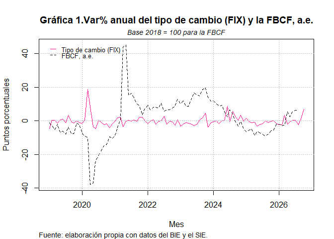

<!-- README.md is generated from README.Rmd. Please edit that file -->

# seriesMX

<!-- badges: start -->

<!-- badges: end -->

seriesMX es un paquete de R que automatiza la descarga, procesamiento,
presentación y actualización de diversos indicadores de la economía
mexicana a través del uso de las API’s WEB del Sistema de Información
Económica (SIE) de Banco de México y del Banco de Información Económica
(BIE) del Instituto Nacional de Estadística y Geografía (INEGI).

En el contexto de dichas API’s institucionales, estas son el medio por
el cual se presentan diversos indicadores al público general para que
investigadores y desarrolladores consulten los datos sin acceso directo
a sus bases de datos internas.

Una API web (Application Programming Interface o Interfaz de
Programación de Aplicaciones) es un conjunto de reglas y protocolos que
permite que diferentes aplicaciones o sistemas se comuniquen e
intercambien datos a través de internet, utilizando principalmente el
protocolo HTTP/HTTPS.

Para más información consulte: <https://www.ibm.com/think/topics/api>

¿Por qué se clasifican como API’s Web?

Para consultar datos no es necesario instalar algún software. En su
lugar, se realiza una petición web (una solicitud HTTP) a una dirección
URL específica provista por el INEGI o Banxico. Al momento de llevar a
cabo la consulta, sus servidores procesan la petición y devuelven la
información en formatos estructurados estándar de intercambio de datos
web, principalmente JSON o JSON-Stat.

Sin embargo, es importante señalar que ambas plataformas requieren que
se lleve a cabo un registro en sus portales de desarrolladores para
obtener un “token” o clave de acceso digital, la cual viaja junto con la
petición web para registar y validar la identidad del usuario.

Cualquier lenguaje de programación que tenga la capacidad de conectarse
a internet (como Python, JavaScript, R, PHP o incluso macros avanzadas
de Excel) puede consumir estas herramientas enviando peticiones HTTPS de
forma remota.

Antes de usar seriesMX, es indispensable que consulte las páginas web
oficiales donde es posible generar los token correspondientes:

- INEGI (BIE/BISE):
  <https://www.inegi.org.mx/app/desarrolladores/generatoken/Usuarios/token_Verify>

- Banco de México (SIE):
  <https://www.banxico.org.mx/SieAPIRest/service/v1/token>

Nota: en la práctica es posible generar diversos token, su propósito
sólo es controlar el flujo de acceso desde los servidores de INEGI y
Banxico.

## Instalación del paquete.

Puede instalar la última versión del paquete “seriesMX” desde
[GitHub](https://github.com/):

``` r
# install.packages("pak")
pak::pak("carrascofernando032/seriesMX")
```

## Ejemplo sobre el uso de las funciones “api_bie” o “api_sie” del paquete seriesMX.

Este es un ejemplo básico que muestra cómo utilizar el token dentro de
la URL correspondiente. Se requieren tres argumentos: url del indicador
que se desea consultar a través de la API, token y formato de respuesta
de la información (json por defecto).

``` r
library(seriesMX)
api_bie(url = paste0("https://www.inegi.org.mx/app/api/indicadores/desarrolladores/jsonxml/INDICATOR/736183/es/00/false/BIE-BISE/2.0/"),
token = "ejemplo_f1a58e29e-8796-409c-9aeb-3206889b2067",
formato_resp = "?type=json")
```

## Especificaciones sobre las funciones api_bie y api_sie.

- Un data frame en R es una estructura de datos bidimensional (en forma
  de tabla con filas y columnas) que permite almacenar datos
  heterogéneos.Es el objeto más utilizado para el análisis estadístico y
  la manipulación de información en R, ya que funciona de forma muy
  similar a una hoja de cálculo de Excel.

- El propósito del “producto final” de las funciones api_bie o api_sie
  es proporcionar un data frame con el que se puedan implementar las
  herramientas intermedias del lenguaje de programación R con énfasis en
  la limpieza, manipulación de datos y visualizaciones avanzadas.

- Debido a que es diferente la información (datos y metadatos de los
  indicadores) que proviene de los servidores del Banco de México e
  INEGI, como el nombre del indicador o la frecuencia de las
  observaciones, se estableció que era fundamental estandarizar los data
  frames que resulten de utilizar api_bie o api_sie para que el ususario
  pueda juntar todas las series utilizando la paquetería Tidyverse.

## Generar una tabla y visualización de los indicadores provenientes del BIE y SIE.

Para utilizar left_join() de Tidyverse, es necesario que las variables
“fecha” tengan el mismo formato y, preferentemente, la misma clase
(Date).

En el siguiente caso se tienen dos formatos: - Data frame 1:
“1992-08-01” (fecha diaria). - Data frame 2: “1992/08” (fecha mensual).

La solución más sencilla es homologar ambas fechas al primer día de cada
mes, pero antes de juntarlas es importante verificar que ambas series
abarquen la misma cantidad de años, trimestres, meses, etc.

- También es posible generar visualizaciones de las series a través de
  la función ts().

- La función ts necesita una matriz con información numérica, por lo que
  se debe eliminar la columna de “fecha”.

``` r
library(tidyverse)
#> Warning: package 'tidyverse' was built under R version 4.6.1
#> Warning: package 'ggplot2' was built under R version 4.6.1
#> Warning: package 'tibble' was built under R version 4.6.1
#> Warning: package 'tidyr' was built under R version 4.6.1
#> Warning: package 'readr' was built under R version 4.6.1
#> Warning: package 'purrr' was built under R version 4.6.1
#> Warning: package 'dplyr' was built under R version 4.6.1
#> Warning: package 'stringr' was built under R version 4.6.1
#> Warning: package 'forcats' was built under R version 4.6.1
#> Warning: package 'lubridate' was built under R version 4.6.1
#> ── Attaching core tidyverse packages ──────────────────────── tidyverse 2.0.0 ──
#> ✔ dplyr     1.2.1     ✔ readr     2.2.0
#> ✔ forcats   1.0.1     ✔ stringr   1.6.0
#> ✔ ggplot2   4.0.3     ✔ tibble    3.3.1
#> ✔ lubridate 1.9.5     ✔ tidyr     1.3.2
#> ✔ purrr     1.2.2     
#> ── Conflicts ────────────────────────────────────────── tidyverse_conflicts() ──
#> ✖ dplyr::filter() masks stats::filter()
#> ✖ dplyr::lag()    masks stats::lag()
#> ℹ Use the conflicted package (<http://conflicted.r-lib.org/>) to force all conflicts to become errors
library(seriesMX)

#Tipo de cambio mensual, fecha de determinación (FIX).
tipo_de_cambio_fix<-api_sie(url = paste0("https://www.banxico.org.mx/SieAPIRest/service/v1/series/SF17908/datos?token="),
token = "5864e518164893a673fa467ac9e759836dbee33aecc73525d1e1f03254e44a50",
formato_resp = "&mediaType=json")

#Variación porcentual anual de la serie desestacionalizada de la Formación Bruta de Capital Fijo (TOTAL)
formacion_bcf<-api_bie(url = paste0("https://www.inegi.org.mx/app/api/indicadores/desarrolladores/jsonxml/INDICATOR/741104/es/00/false/BIE-BISE/2.0/"),
token = "c1a58e29e-8796-409c-9aeb-3206889b2005",
formato_resp = "?type=json")

tipo_de_cambio_fix <- tipo_de_cambio_fix%>%
  mutate(fecha = as.Date(fecha))%>%
  filter(fecha >= "1994-01-01")

formacion_bcf<- formacion_bcf%>%
  mutate(fecha = as.Date(paste0(
    gsub("/", "-", fecha), "-01")))

fix_fbcf<- tipo_de_cambio_fix%>%
  left_join(formacion_bcf, by = "fecha")%>%
  rename(fix=observacion.x, fbcf=observacion.y)%>%
  select(fecha, fix, fbcf)%>%
  filter(fecha >= as.Date("2018-01-01"))

head(fix_fbcf)
#>        fecha     fix       fbcf
#> 1 2018-01-01 18.9074 -0.4555279
#> 2 2018-02-01 18.6449  2.1005742
#> 3 2018-03-01 18.6308  1.6259466
#> 4 2018-04-01 18.3872  2.9199767
#> 5 2018-05-01 19.5910  2.6252223
#> 6 2018-06-01 20.3032  1.4187628

#Para calcular la variación porcentual anual del tipo de cambio FIX, agregarla al data frame y graficarlo junto con la serie FBCF:

ts.plot((serie_ts<- ts(data = (fix_fbcf%>%
                                 mutate(var_anual_FIX = (fix - lag(fix, n = 1)) /lag(fix, n = 1)*100)%>%
                                 filter(fecha >= as.Date("2019-01-01"))%>%
                                 select(var_anual_FIX, fbcf)), frequency = 12, 
                       start = c(2019, 1))),
        main = "Gráfica 1.Var% anual del tipo de cambio (FIX) y la FBCF, a.e.",
  xlab = "Mes",
  ylab = "Puntos porcentuales", 
  col = c("#FF1493", "black"),
  lty = c(1, 2))

grid(col = "grey", lty = "dotted")

legend("topleft",legend=c("Tipo de cambio (FIX)","FBCF, a.e."),
                          col=c("#FF1493", "black"),
       lty = c(1, 2),
       seg.len = 1,
       cex = 0.8,
       xpd = TRUE,
       inset = c(0.02, 0.02),
       bty = "n",
       y.intersp = 0.8)

mtext("Fuente: elaboración propia con datos del BIE y el SIE.", 
      side=1, line=4.1, adj=0, cex=0.85)
mtext("Base 2018 = 100 para la FBCF", side=3, line=0.3, cex=0.89, font=3, col="black")
```


