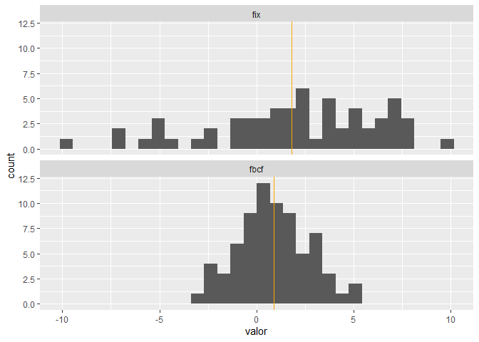

<!-- README.md is generated from README.Rmd. Please edit that file -->

# seriesMX

<!-- badges: start -->

<!-- badges: end -->

Las API’s web institucionales son el medio por el cual se presentan
diversos indicadores de la economía mexicana al público general para que
investigadores y desarrolladores consulten los datos de una manera
eficiente y segura.

seriesMX es un paquete de R que automatiza la descarga, procesamiento,
presentación y actualización de diversos indicadores de la economía
mexicana a través del uso de las API’s web del Sistema de Información
Económica (SIE) de Banco de México (Banxico), y del Banco de Información
Económica (BIE) del Instituto Nacional de Estadística y Geografía
(INEGI).

¿Por qué se clasifican como API’s Web?

Una API web (Application Programming Interface o Interfaz de
Programación de Aplicaciones) es un conjunto de reglas y protocolos que
permite que diferentes aplicaciones o sistemas se comuniquen e
intercambien datos a través de internet, utilizando principalmente el
protocolo HTTP/HTTPS.

Para más información consultar: <https://www.ibm.com/think/topics/api>

En ese sentido, para acceder a los datos a través de las API’s web no es
necesario instalar algún software. En su lugar, se realiza una petición
web (una solicitud HTTP) por medio de una dirección URL específica
provista por los sistemas informáticos de INEGI y Banxico. Al momento de
llevar a cabo la consulta, sus servidores procesan la petición y
devuelven la información en formatos estructurados estándar de
intercambio de datos web, principalmente JSON o JSON-Stat.

Sin embargo, es importante señalar que ambos sistemas requieren que se
lleve a cabo un registro en sus “portales de desarrolladores” para
obtener un “Token” o clave de acceso digital, la cual viaja junto con la
petición web para registar y validar el acceso del usuario.

# Enlace del portal de desarrolladores de la API del Banco de Indicadores (BIE) o del Sistema de Información Económica (SIE)

A través de estos portales, los desarrolladores o analistas que
requieren la automatización del proceso de extracción de información
económica publicada por INEGI y Banxico, pueden acceder a los datos
correspondientes.

- INEGI (BIE/BISE):
  <https://www.inegi.org.mx/servicios/api_indicadores.html>

- Banxico (SIE): <https://www.banxico.org.mx/SieAPIRest/service/v1/>

Para consultar la dirección URL de la información asociada a los
indicadores, los usuarios deben seleccionar el “Constructor de
Consultas” en el caso del API de INEGI o el “Catálogo de series” en el
caso de Banxico.

Cualquier lenguaje de programación que tenga la capacidad de conectarse
a internet (como Python, R o incluso macros avanzadas de Excel) puede
consumir estas herramientas enviando peticiones HTTPS de forma remota.

# Acceso al Token de autenticación para realizar las peticiones de información al API del BIE o SIE

Antes de usar seriesMX, es indispensable consultar los siguientes
enlaces para generar los token correspondientes:

- INEGI (BIE/BISE):
  <https://www.inegi.org.mx/app/desarrolladores/generatoken/Usuarios/token_Verify>

- Banco de México (SIE):
  <https://www.banxico.org.mx/SieAPIRest/service/v1/token>

Nota: en la práctica es posible generar más de un token, su propósito
sólo es controlar el flujo de acceso a las API’s desde los servidores de
INEGI y Banxico.

# Instalación del paquete

Puede instalar la última versión del paquete “seriesMX” desde
[GitHub](https://github.com/):

``` r
# install.packages("pak")
pak::pak("carrascofernando032/seriesMX")
```

# Módulo 1. Consumo e integración de las API’s de INEGI y Banxico

En seriesMX, las funciones denominadas “api_bie” y “api_sie” son los
componentes del paquete que conectan y extraen información de las API’s
de INEGI y Banxico.

## ¿Qué hacen exactamente las funciones api_bie y api_sie?

Consumen las API’s de INEGI o Banxico (por ejemplo, consultando el tipo
de cambio) para obtener información, toman los datos que reciben y los
adaptan para que puedan ser usados, guardados o procesados por R, y
estandarizan el formato de los datos (JSON o XML) controlando los
errores, tiempos de espera y la seguridad (Tokens).

- API del Banco de Información Económica (BIE / INEGI): la función
  “api_bie” automatiza las solicitudes de información a la API de INEGI
  utilizando el token de desarrollador.
- API del Sistema de Información Económica (SIE / Banxico): la función
  “api_sie” es equivalente a “api_bie” para consultar información de
  Banco de México.

# ¿Cómo consultar información a través de la API de INEGI o Banxico?

Ejemplo api_bie - INEGI. Var% anual de la serie desestacionalizada del
Producto Interno Bruto (base 2018).

Argumentos:

- URL del indicador que se desea consultar a través de la API:
  “<https://www.inegi.org.mx/app/api/indicadores/desarrolladores/jsonxml/INDICATOR/736183/es/00/false/BIE-BISE/2.0/>”

- Token de autenticación: Usar la función tokens() de seriesMX para
  configurar token_bie.

- Formato de respuesta de la información: JSON por construcción del
  paquete seriesMX.

Ejemplo api_sie - Banxico. Tipo de cambio mensual, fecha de
determinación (FIX).

Argumentos: - URL del indicador que se desea consultar a través de la
API:
“<https://www.banxico.org.mx/SieAPIRest/service/v1/series/SF17908/datos?token=>”

- Token de autenticación: Usar la función tokens() de seriesMX para
  configurar token_sie.

- Formato de respuesta de la información: JSON por construcción del
  paquete seriesMX.

# Módulo 2. Resultado de api_bie y api_sie

## Data frame

Un data frame en R es una estructura de datos bidimensional (en forma de
tabla con filas y columnas) que permite almacenar datos heterogéneos.Es
el objeto más utilizado para el análisis estadístico y la manipulación
de información en R, ya que funciona de forma similar a una hoja de
cálculo de Excel.

Con un data frame se pueden implementar las herramientas intermedias del
lenguaje de programación R con énfasis en la limpieza, manipulación de
datos y visualizaciones avanzadas.

Debido a la heterogenidad en la información que proviene de los
servidores del Banco de México e INEGI (datos, metadatos, el nombre del
indicador o la frecuencia de las observaciones) api_bie y api_sie
estandarizan los data frames que resulten de utilizar estas funciones.

``` r
library(seriesMX)

tokens(token_bie = Sys.getenv("token_bie_get"),
       token_sie = Sys.getenv("token_sie_get"))

pib_ae_736183<-"https://www.inegi.org.mx/app/api/indicadores/desarrolladores/jsonxml/INDICATOR/736183/es/00/false/BIE-BISE/2.0/"

api_bie(pib_ae_736183)
```

# Módulo 3. Unión y visualización de los datos a través de una variable en común: periodo de tiempo

Este módulo está diseñado para tomar los datos extraídos de las API de
BIE (INEGI) y SIE (Banco de México) y generar visualizaciones de las
series. En la ciencia de datos es común tener que unir bases entre sí,
pues un álisis no implica trabajar con una sola base o dataframe, al
contrario, se suele trabajar con múltiples bases y generalmente (casi
siempre) se requiere combinarlas para dar respuesta a las preguntas que
motivan el análisis.

La idea fundamental es: agregar nuevas variables a un marco de datos a
partir de observaciones coincidentes en otro.

En el siguiente caso se tienen dos formatos: - Data frame 1:
“1992-08-01” (fecha diaria). - Data frame 2: “1992/08” (fecha mensual).

Se deben homologar las fechas al primer día de cada mes. Sin embargo,
antes de unir los data frames es importante verificar que ambas series
abarquen el mismo periodo de tiempo.

## Familia Join de la colección Tidyverse en R

Tidyverse es una colección de paquetes de código abierto para R,
diseñados específicamente para la ciencia de datos.

Tidyverse, a través del paquete denominado dplyr, tiene una familia de
funciones llamada “join”. Sus integrantes son: left, rigth, inner, full,
semi y anti, todos de apellido “\_join”. Cada uno de los integrantes de
la familia tiene su peculiaridad, pero todos coinciden en que la unión
de datos debe ser a través de una(s) variable(s) en común.

Para utilizar la función “left_join()” de Tidyverse, es necesario que
las variables “fecha” tengan el mismo formato y, preferentemente, la
misma clase (Date).

## Gráfica de series de tiempo a partir de datos del BIE (INEGI) y del SIE (Banxico) con la función “graficar_ts” de seriesMX

La función “graficar_ts” de seriesMX automatiza la construcción de una
gráfica de series de tiempo a partir de un data frame con una columna de
fechas y una o más columnas numéricas (indicadores), como el resultado
de unir con `left_join()` los data frames individuales devueltos por
api_bie() y api_sie().

``` r
#Paquetería necesaria.
library(tidyverse)
#> Warning: package 'tidyverse' was built under R version 4.6.1
#> Warning: package 'ggplot2' was built under R version 4.6.1
#> Warning: package 'tibble' was built under R version 4.6.1
#> Warning: package 'tidyr' was built under R version 4.6.1
#> Warning: package 'readr' was built under R version 4.6.1
#> Warning: package 'purrr' was built under R version 4.6.1
#> Warning: package 'dplyr' was built under R version 4.6.1
#> Warning: package 'stringr' was built under R version 4.6.1
#> Warning: package 'forcats' was built under R version 4.6.1
#> Warning: package 'lubridate' was built under R version 4.6.1
#> ── Attaching core tidyverse packages ──────────────────────── tidyverse 2.0.0 ──
#> ✔ dplyr     1.2.1     ✔ readr     2.2.0
#> ✔ forcats   1.0.1     ✔ stringr   1.6.0
#> ✔ ggplot2   4.0.3     ✔ tibble    3.3.1
#> ✔ lubridate 1.9.5     ✔ tidyr     1.3.2
#> ✔ purrr     1.2.2     
#> ── Conflicts ────────────────────────────────────────── tidyverse_conflicts() ──
#> ✖ dplyr::filter() masks stats::filter()
#> ✖ dplyr::lag()    masks stats::lag()
#> ℹ Use the conflicted package (<http://conflicted.r-lib.org/>) to force all conflicts to become errors
library(seriesMX)

#Configuración de los tokens de autenticación del BIE y Sie para utilizar las funciones api_bie y api_sie.

tokens(token_bie = Sys.getenv("token_bie_get"),
       token_sie = Sys.getenv("token_sie_get"))
#> Tokens configurados exitosamente en esta sesion: BIE, SIE

#Sys.getenv("token_bie_get") lee tu token real desde el .Renviron, así que el código no lo expone para este ejemplo.

#Tipo de cambio mensual, fecha de determinación (FIX).

tipo_de_cambio_fix<-api_sie(url = "https://www.banxico.org.mx/SieAPIRest/service/v1/series/SF17908/datos?token=")

#Variación porcentual anual de la serie desestacionalizada de la Formación Bruta de Capital Fijo (TOTAL).

formacion_bcf<-api_bie(url = "https://www.inegi.org.mx/app/api/indicadores/desarrolladores/jsonxml/INDICATOR/741104/es/00/false/BIE-BISE/2.0/")

#Homologación de las fechas:

tipo_de_cambio_fix <- tipo_de_cambio_fix%>%
  mutate(fecha = as.Date(fecha))%>%
  filter(fecha >= "1994-01-01")

formacion_bcf<- formacion_bcf%>%
  mutate(fecha = as.Date(paste0(
    gsub("/", "-", fecha), "-01")))

# Unión por fecha y variación anual del FIX:

fix_fbcf<- tipo_de_cambio_fix%>%
  left_join(formacion_bcf, by = "fecha")%>%
  rename(fix=observacion.x, fbcf=observacion.y)%>%
  mutate(var_anual_fix = (fix / lag(fix, n = 12) - 1) * 100)%>%
  select(fecha, fbcf, var_anual_fix)

#Usar la función "graficar_ts" de seriesMX: 

graficar_ts(df = fix_fbcf,
  inicio = "2019-01-01",
  titulo = "Gráfica 1. Var% anual del tipo de cambio (FIX) y la FBCF, a.e.",
  ejey = "Puntos porcentuales",
  etiquetas = c("Formación Bruta de Capital Fijo, a.e.", "Tipo de cambio (FIX)"),
  fuente = "Fuente: elaboración propia con datos del BIE (INEGI) y el SIE (Banxico).",
  subtitulo = "Base 2018 = 100 para la FBCF, a.e.")
```


# Módulo 4. Transformaciones y aritmética porcentual

Este módulo pretende proporcionar una metodología adecuada para el
cálculo de tasas y variaciones porcentuales de las series de
indicadores, evitando errores comunes de suma, resta, multiplicación y
división directa de porcentajes.

## Función “estadisticos_ts” del paquete seriesMX

Calcula estadísticos descriptivos de una o varias series de tasas de
variación porcentual: número de observaciones, máximo, mínimo, media
geométrica, media aritmética, mediana, desviación estándar, primer y
tercer cuartil, rango intercuartílico, sesgo y curtosis.

Específicamente, la función tiene como propósito calcular la tasa de
crecimiento o variación porcentual promedio compuesta de una o varias
series de tiempo a partir de sus variaciones porcentuales periódicas.

``` r

# Datos simulados: 72 meses desde enero de 2018.
# fix: caminata aleatoria en torno a 19 pesos por dólar (nivel).
# fbcf: variación anual simulada, con una distribución normal con media 1 y desviación 2.

set.seed(123)
datos <- data.frame(
  fecha = seq(as.Date("2018-01-01"), by = "month", length.out = 72),
  fix = 18 + cumsum(rnorm(72, 0.02, 0.3)),
  fbcf = rnorm(72, 1, 2))

# Variación porcentual anual del FIX (la FBCF ya está en variación anual):
datos$fix <- c(rep(NA, 12), (datos$fix[13:72] / datos$fix[1:60] - 1) * 100)

#Resultado:
estadisticos_ts(df = datos)
#>   indicador observaciones   maximo    minimo     media media_aritmetica
#> 1       fix            60 9.818249 -9.797683 1.8161194        1.9082271
#> 2      fbcf            72 5.374666 -3.106494 0.8743851        0.8908638
#>     mediana desv_esta         Q1       Q3      RIQ      sesgo curtosis
#> 1 2.4120451  4.327793 -0.3087250 5.105226 5.413951 -0.6080405 2.877423
#> 2 0.7898006  1.838247 -0.3219292 2.053309 2.375238  0.2061461 2.688179

#Panel de histogramas de las series de indicadores junto con sus estadísticos descriptivos.
comparar_est_ts(datos,  indicadores = NULL, 
                estadistico = "media",
                bins = 30, ncol = 1, 
                escalas = "fixed")
```


